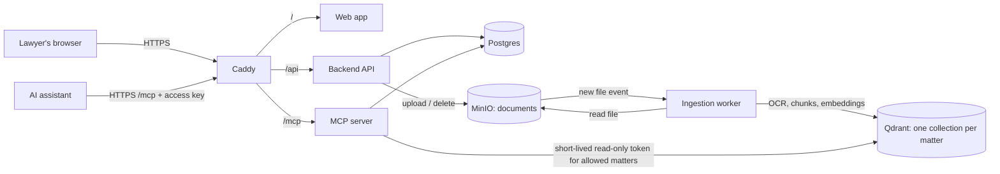

# ragConsumer

A private document search for a law firm, built so that lawyers can ask an AI
assistant (Claude, ChatGPT or any assistant that supports MCP) about **their own
matters' documents** without those documents leaving the firm's server or being
mixed with other matters'.

- Documents are organised by **matter**. Each matter has its own members with a
  role (viewer, editor, owner). Nobody sees a matter they are not a member of.
- Lawyers upload files (PDF, scanned PDF, Word, email, and more; folders and zip
  files too). Scanned pages are read with OCR. Documents are in **Spanish** and the
  search is tuned for it.
- Each lawyer connects their own AI assistant with a personal access key and
  chooses, matter by matter, what that assistant may search. The assistant can only
  ever reach what that person is allowed to see **and** has switched on.
- Accounts are **invite-only**, and an administrator can disable a person (sessions end
  and AI keys stop at once) or issue a password reset. Every sign-in, upload, deletion,
  sharing change and AI search is written to an append-only audit log.
- The web app is in Spanish by default, with an English switch.

Intended for a single firm's pilot on its own cloud server. The first real users
are a law firm, so isolation between matters and confidentiality outrank
convenience in every design decision.

## How it fits together



| Part | Folder | What it does |
|---|---|---|
| Web app | `frontend/` | React + TypeScript. Matters, uploads, members, the Connect page, admin. |
| Backend API | `backend/` | FastAPI + Postgres. Accounts, invitations, matters and roles, uploads, audit log, personal access keys. |
| Ingestion worker | `ingestion_worker/` | Turns uploaded files into searchable fragments: text extraction, OCR, chunking, Spanish-tuned embeddings. Document records in Postgres are its durable queue. |
| MCP server | `mcp_server/` | What AI assistants talk to. Re-checks the person's access on **every** call and searches only their allowed matters. |
| Database setup | `backend/scripts/` | A one-shot `migrate` step brings the schema up to date and gives each service its own limited database account; only it holds the owner's password. |
| Edge | `deploy/` | Caddy (HTTPS, headers), server hardening, backups, deploy, monitoring. |

### Why matters cannot leak into each other

Four layers, each enough to stop a mistake in the others:

1. Per-matter roles on every API route (a non-member gets "not found").
2. The AI assistant's own per-matter switch, intersected with membership on every call.
3. One search collection per matter in Qdrant.
4. Qdrant is not reachable from outside; the MCP server uses a 60-second read-only
   token scoped to exactly the allowed matters, and the isolation is proven by a
   live check in the test suite.

## Run it on your computer

Needs Docker (Compose v2) and Python 3.

```bash
python scripts/generate_env.py                 # writes .env with fresh random secrets
docker compose up -d --build                   # the first start downloads ~600 MB of search models per service
docker compose exec -it backend python scripts/create_admin.py --email you@example.com
```

Open <http://localhost:5173> and sign in. The admin page invites everyone else.
Other local addresses: API `:8000`, MCP server `:8002`, MinIO console `:9001`.
Demo accounts and matters for development only: `docker compose exec backend python scripts/seed.py`
(known passwords, so never run it on a server).

For hot reload while developing: `docker compose -f docker-compose.yml -f docker-compose.dev.yml up`.

Configuration lives in `.env`; every setting is explained in `.env.example`
(`python scripts/check_env_example.py` keeps the two in step).

## Tests and checks

```bash
bash .claude/skills/run-checks/run-checks.sh            # all test suites
bash .claude/skills/run-checks/run-checks.sh --stack    # plus health of the running stack and the live Qdrant isolation check
```

That runs the backend, MCP server and worker test suites, the `.env.example`
check, the backup retention tests, TypeScript, the web app's tests and the linter.
Heavier rehearsals, which build scratch copies and touch nothing real:

| Command | What it proves |
|---|---|
| `bash deploy/test-backup.sh` | A backup of the running stack restores into an empty one, and the two match |
| `bash deploy/test-deploy.sh` | First deploy, a release with a migration, a broken release that rolls back by itself, manual rollback, monitoring alerts |
| `bash deploy/test-hardening.sh` | Server hardening and timers on a real systemd Ubuntu machine |
| `eval/` | How well search finds the right Spanish legal document (see `eval/README.md`) |

## Putting it on a server

Read `docs/deployment/` in order:

1. `01-provider-options.md` where to host it and what it costs
2. `02-reverse-proxy.md` the single HTTPS address and the production compose file
3. `03-server-hardening.md` locking the server down before it holds documents
4. `04-secrets.md` where the secrets live and how to rotate them
5. `05-backups.md` encrypted nightly backups and how to restore
6. `06-deploy-and-rollback.md` staging, releasing, rolling back
7. `07-monitoring.md` alerts and log retention

How sign-in, sessions, password resets and offboarding a person work: `docs/account-security.md`.
What is protected, by what, and the limits that remain: `docs/security-notes.md`.

## Where documents go

Uploaded documents are stored on the server. **Searching is different:** when a
lawyer uses an AI assistant, the passages it finds are sent to that assistant's
provider (Anthropic, OpenAI, ...) under the lawyer's own account with them. That is
a property of using any hosted AI assistant, not of this system, and the firm's
policies need to cover it. Read `docs/aviso-de-confidencialidad.md` (in Spanish) before the
pilot starts; lawyers get a plain-language guide in `docs/guia-de-usuario.md`.

## Repository conventions

Work is tracked in Jira (project KAN). One branch per epic, one commit per ticket
with its key in the message, pull requests into `main` merged with a merge commit.
Details and the list of helper agents and skills are in `CLAUDE.md`.

## License

Proprietary, all rights reserved (see `LICENSE`). Third-party components keep their
own licenses (see `THIRD_PARTY_NOTICES.md`).
